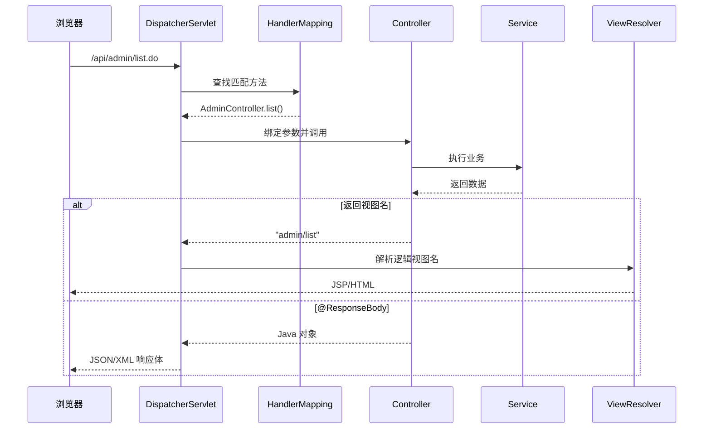

# MVC 思想与 SpringMVC 架构

> [!info] 课堂来源
> 录制 1，约 00:00–09:22；录制 6，约 00:32–03:13。讲义对应第 3–49、1298–1301 行。

## 先从职责分离理解 MVC

MVC 不是“写三个包”这么简单。它要解决的是：数据如何产生、页面如何呈现、谁来调度两者。

| 角色 | 主要职责 | 常见实现 |
|---|---|---|
| 模型 Model | 处理业务、保存状态、产出一份与显示无关的数据 | JavaBean、Service、实体/VO |
| 视图 View | 收集用户输入、展示数据 | JSP、HTML、Vue 页面 |
| 控制器 Controller | 接收请求、组织模型和视图、调度业务 | Servlet、SpringMVC Controller |

课堂中特别强调：

- 视图有两个典型作用：**收集数据**（表单）和**展示数据**（表格、弹框、页面）。
- 模型只给数据，不负责决定页面长什么样。
- 同一个模型可以对应多个视图。例如管理员与普通用户看到不同页面，但底层数据模型可以共用。
- 多个视图也可以复用一个模型/控制器，例如同一模块的增删改查由一组控制器方法组织。

> [!note] 一句话判断
> 数据是什么属于 Model；数据怎样显示属于 View；请求交给谁处理属于 Controller。

## 模型 MVC 与三层架构

```text
表示层：Controller + View
业务层：Service
数据访问层：Mapper / DAO
```

三层架构与 MVC 不是同一维度的概念：

- 三层架构关心整个应用如何纵向分层。
- MVC 主要描述表示层内部如何协作。
- Controller 不等于整个三层架构，Service 和 Mapper 也不属于 View。

## Model1 与 Model2

### Model1：JSP + JavaBean

```text
浏览器 → JSP（页面、控制、业务混杂） → JavaBean
```

特点：

- JSP 既当视图，又承担部分控制甚至业务逻辑。
- 页面、流程、数据访问耦合在一起。
- 小页面开发快，但后续维护困难，课堂评价为“最低级”的模型。

### Model2：JSP + Servlet + JavaBean

```text
浏览器 → Servlet（控制器） → JavaBean / 业务 → JSP（视图）
```

特点：

- Servlet 接手请求分发和流程控制。
- JSP 主要回到视图职责。
- 已经具备 MVC 雏形，但每个 Servlet 都要自行处理大量重复工作。

SpringMVC 在此基础上提供统一的 `DispatcherServlet`、映射器、适配器、参数绑定、消息转换和视图解析。

## 为什么还需要前端控制器

如果每个 Servlet 都自己接收请求、查找业务、选择页面，会产生大量重复代码。SpringMVC 用一个统一入口集中处理公共流程：

1. `DispatcherServlet` 接收请求。
2. `HandlerMapping` 根据 URL、HTTP 方法、参数、请求头等找到 Controller 方法。
3. `HandlerAdapter` 调用对应方法并处理参数绑定。
4. Controller 调用 Service。
5. 方法返回视图名或响应体。
6. 若返回视图名，`ViewResolver` 解析 JSP/HTML；若使用 `@ResponseBody`，`HttpMessageConverter` 写 JSON/XML。

> [!tip] 前端控制器不是业务控制器
> `DispatcherServlet` 是框架的统一调度入口；`AdminController` 等才是开发者编写的具体处理器。前者负责“把请求交给谁”，后者负责“具体做什么”。

## SpringMVC 核心组件

| 组件 | 作用 |
|---|---|
| `DispatcherServlet` | 前端控制器，统一接收并协调请求 |
| `HandlerMapping` | 根据请求条件匹配处理器 |
| `HandlerAdapter` | 以统一方式调用不同类型的处理器 |
| `HandlerExceptionResolver` | 处理控制器执行中的异常 |
| `ViewResolver` | 把逻辑视图名解析成具体视图 |
| `HttpMessageConverter` | Java 对象与 JSON、XML、文本之间的转换 |
| `MultipartResolver` | 解析 `multipart/form-data` 文件上传请求 |

## 一次请求的完整时序



## 关键区别

| 对比 | 说明 |
|---|---|
| Model 与实体类 | 实体类通常对应表结构；Model 还可以是 VO、Map、聚合结果 |
| View 与 JSP | JSP 是一种视图技术，不是视图的全部 |
| Controller 与 Service | Controller 处理 Web 协议和流程；Service 处理业务规则 |
| 前端控制器与具体控制器 | 前者统一调度，后者处理具体 URL |
| 返回视图名与返回响应体 | 取决于是否有 `@ResponseBody`/`@RestController` 以及视图解析配置 |

## 易错点

> [!warning] 三个常见误区
> 1. 把 MVC 等同于三层架构。
> 2. 认为 Controller 中写数据库 SQL 才算“业务在控制器里”。
> 3. 认为 `DispatcherServlet` 会直接执行业务逻辑。

- 业务逻辑应主要在 Service 中；Controller 负责协议适配、参数校验和结果组织。
- 视图解析器缺失时，返回普通字符串可能得到 404，而不是页面文本。
- `@ResponseBody` 跳过视图解析，但不会自动等同于 HTTP 200；真实状态码仍需按需设置。

## 自测

1. Model1 和 Model2 的核心区别是什么？
2. 为什么一个模型可以对应多个视图？举一个登录前后的例子。
3. `DispatcherServlet`、HandlerMapping、HandlerAdapter 各自负责什么？
4. 返回 `"hello"` 时，什么情况下会找 `hello.jsp`，什么情况下会直接输出 `hello`？

## 关联

- 下一篇：[[2.SSM环境搭建与项目启动]]
- 返回结果：[[5.返回值、视图解析与统一响应]]
- 课堂代码：`AdminController`、`Admin2Controller`
