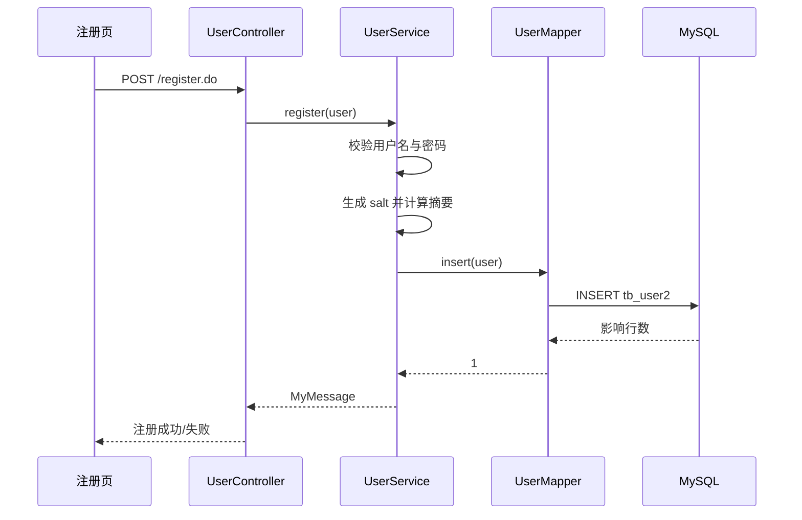

# 注册、登录与分页查询

> [!info] 讲义补充
> 本节依据讲义第 5139–5752、6083–6408 行整理。录播结尾只布置了三层开发作业，注册登录与分页细节来自讲义。

## 用户表设计

```sql
CREATE TABLE tb_user2 (
    user_id INT PRIMARY KEY AUTO_INCREMENT,
    user_login_name VARCHAR(20) NOT NULL UNIQUE,
    user_pwd CHAR(32) NOT NULL,
    user_salt CHAR(10) NOT NULL,
    user_name VARCHAR(20),
    user_salt_index INT DEFAULT 0,
    user_state INT DEFAULT 0,
    user_error INT DEFAULT 0
);
```

字段含义：

| 字段 | 含义 |
|---|---|
| `user_login_name` | 登录名，唯一 |
| `user_pwd` | 密码摘要，不存明文 |
| `user_salt` | 随机盐 |
| `user_salt_index` | 课堂加密演示用索引 |
| `user_state` | 0 正常、1 禁用、2 删除 |
| `user_error` | 连续密码错误次数 |

> [!tip] 唯一约束是最后防线
> 即使前端 Ajax 已检查用户名，数据库仍必须有唯一索引；并发注册时前端检查无法保证唯一性。

## 注册链路



Controller：

```java
@RequestMapping("/register")
@ResponseBody
public MyMessage<Long> register(@ModelAttribute User2 user) {
    return userService.register(user);
}
```

Service：

```java
@Override
@Transactional(rollbackFor = Exception.class)
public MyMessage<Long> register(User2 user) {
    if (userMapper.findByLoginName(user.getUserLoginName()) != null) {
        return message(false, "用户名已被占用");
    }

    String salt = RandomStringUtils.randomAlphabetic(10);
    int index = ThreadLocalRandom.current().nextInt(10);
    user.setUserSalt(salt);
    user.setUserSaltIndex(index);
    user.setUserPwd(MD5Util.md5To32String(user.getUserPwd(), salt, index));

    int count = userMapper.insert(user);
    if (count != 1) {
        throw new IllegalStateException("注册失败");
    }
    return message(true, "注册成功", user.getUserId());
}
```

> [!note] 辅助方法
> 为避免重复样板代码，上面的 `message(...)` 表示在 Service 中自行封装的辅助方法：内部创建 `MyMessage`，设置 `success`、`msg` 和 `tag` 后返回。课堂原始 `MyMessage` 只有 Lombok 生成的标准 setter，没有 `ok/fail` 静态工厂。

服务端必须校验：

- 登录名非空、长度、字符规则。
- 密码强度、确认密码。
- 用户名是否重复。
- 状态默认值不能被客户端篡改。
- 注册接口限流与验证码。

## 登录链路

```java
@Override
public MyMessage<User2> login(User2 input) {
    User2 user = userMapper.findByLoginName(input.getUserLoginName());

    if (user == null) {
        return message(false, "用户名或密码错误");
    }
    if (user.getUserState() != 0) {
        return message(false, "账户已被禁用");
    }

    String candidate = MD5Util.md5To32String(
            input.getUserPwd(),
            user.getUserSalt(),
            user.getUserSaltIndex()
    );

    if (!candidate.equalsIgnoreCase(user.getUserPwd())) {
        user.setUserError(user.getUserError() + 1);
        if (user.getUserError() >= 5) {
            user.setUserState(1);
        }
        userMapper.updateLoginState(user);
        return message(false, user.getUserError() >= 5
                ? "连续 5 次密码错误，账户已锁定"
                : "用户名或密码错误");
    }

    user.setUserError(0);
    userMapper.updateLoginState(user);
    return message(true, "登录成功", user);
}
```

### 登录错误设计

- “用户不存在”和“密码错误”通常统一提示，避免账号枚举。
- 错误次数达到阈值后锁定账户。
- 成功登录后清空错误次数。
- 登录成功后再写入 Session 或签发 Token。
- 锁定、删除等状态必须服务端判断。

## 注册与登录的 Controller

```java
@Controller
@RequestMapping("/user")
public class UserController {
    @Autowired
    private UserService userService;

    @RequestMapping(value = "/register", produces = "application/json;charset=UTF-8")
    @ResponseBody
    public MyMessage<Long> register(@ModelAttribute User2 user) {
        return userService.register(user);
    }

    @RequestMapping(value = "/login", produces = "application/json;charset=UTF-8")
    @ResponseBody
    public MyMessage<User2> login(@ModelAttribute User2 user,
                                  HttpSession session) {
        MyMessage<User2> result = userService.login(user);
        if (result.getSuccess()) {
            session.setAttribute("loginUser", result.getTag());
        }
        return result;
    }
}
```

> [!warning] 不要把完整用户对象直接放 Session
> 可只保存用户 ID、显示名和权限摘要。密码摘要、盐、错误次数等字段不应进入前端响应或会话快照。

## PageHelper 分页

依赖：

```xml
<dependency>
    <groupId>com.github.pagehelper</groupId>
    <artifactId>pagehelper</artifactId>
    <version>5.3.1</version>
</dependency>
```

MyBatis 配置：

```xml
<plugins>
    <plugin interceptor="com.github.pagehelper.PageInterceptor"/>
</plugins>
```

Service/Controller：

```java
@RequestMapping("/list")
public String list(@RequestParam(defaultValue = "1") int pageNum,
                   @RequestParam(defaultValue = "10") int pageSize,
                   Model model) {
    PageHelper.startPage(pageNum, pageSize);

    List<User2> users = userMapper.selectAll();

    PageInfo<User2> pageInfo = new PageInfo<>(users);
    model.addAttribute("pageInfo", pageInfo);
    return "user/list";
}
```

> [!important] 顺序
> `PageHelper.startPage(...)` 必须紧挨着真正执行查询的 Mapper 方法调用。中间插入其他查询，分页拦截器可能作用到错误的 SQL。

## PageInfo 常用字段

| 字段 | 含义 |
|---|---|
| `pageNum` | 当前页 |
| `pageSize` | 每页条数 |
| `size` | 当前页实际条数 |
| `total` | 总记录数 |
| `pages` | 总页数 |
| `isFirstPage` | 是否首页 |
| `isLastPage` | 是否末页 |
| `hasPreviousPage` | 是否有上一页 |
| `hasNextPage` | 是否有下一页 |

## 分页输入防护

```java
int safePageNum = Math.max(1, pageNum);
int safePageSize = Math.min(Math.max(1, pageSize), 100);
```

必须限制：

- 页数不能为负。
- 每页大小不能无限大。
- 排序字段不能直接拼接用户输入。
- 总页数变化后，当前页可能越界。

## 易错点

- 前端检查用户名只是体验优化，数据库唯一约束才是最终保障。
- 注册时应忽略客户端传入的 `userState`、`userError` 等管理字段。
- 密码加密后不能再拿密文当明文二次加密。
- 事务方法内吞掉异常会导致无法回滚。
- PageHelper 只能用于 MyBatis 查询，不能对任意 Java 列表自动分页。
- 分页参数 `pageSize` 不设上限会造成数据库压力。

## 自测

1. 为什么用户名唯一性必须在数据库层保证？
2. 连续密码错误次数应该存在哪里？为什么？
3. 登录成功和失败时分别如何处理错误次数？
4. `PageHelper.startPage` 为什么必须紧挨查询？
5. 如何防止 `pageSize=1000000`？

## 关联

- 上一篇：[[10.SSM整合、事务、加密与验证码]]
- 下一篇：[[12.JSTL、EL、Druid与单元测试]]
- Ajax 校验：[[8.类型转换器与Ajax]]

