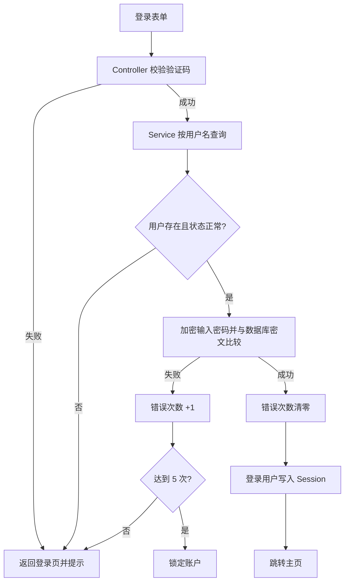

# 页面跳转、登录与静态资源

> [!info] 讲义补充
> 本节依据讲义第 2022–2389 行整理。录播未完整演示登录页与静态资源释放，属于后续讲义补充内容。

## 默认视图跳转

返回普通视图名时，SpringMVC 默认通过视图解析器生成内部转发：

```java
@RequestMapping("/list")
public String list(Model model) {
    model.addAttribute("list", userService.list());
    return "admin/list";
}
```

逻辑视图：

```text
前缀 + admin/list + 后缀
```

若视图解析器为 `/WEB-INF/jsp/` 和 `.jsp`，实际路径为：

```text
/WEB-INF/jsp/admin/list.jsp
```

## forward：请求转发

```java
@RequestMapping("/forward")
public String forward(HttpServletRequest request) {
    request.setAttribute("name", "张三");
    return "forward:/a.jsp";
}
```

特点：

- 服务器内部跳转，浏览器地址不变。
- 只发生一次请求。
- request 作用域数据仍可读取。
- 目标可以为受 `WEB-INF` 保护的资源。

## redirect：重定向

```java
@RequestMapping("/redirect")
public String redirect() {
    return "redirect:/login.do";
}
```

特点：

- 服务器返回 3xx，浏览器重新发起请求。
- 地址栏会变成目标 URL。
- 原 request 作用域数据丢失。
- 需要跨请求传递的提示消息要使用 Session、Flash Attribute 或查询参数。

| 对比 | forward | redirect |
|---|---|---|
| 请求次数 | 1 | 2 |
| 发生位置 | 服务器内部 | 浏览器重新请求 |
| 地址栏 | 不变 | 改变 |
| request 属性 | 保留 | 丢失 |
| 典型用途 | 页面渲染、内部页面 | 登录后跳转、防重复提交 |

## 登录功能链路

讲义中的登录流程：



Controller 关键步骤：

```java
@RequestMapping("/login")
public String login(@RequestParam("adminLoginName") String username,
                    @RequestParam("adminPwd") String password,
                    @RequestParam("imageCode") String code,
                    HttpServletRequest request) {
    if (!code.equalsIgnoreCase((String) request.getSession()
            .getAttribute("imageCode"))) {
        request.setAttribute("message", "验证码错误");
        return "login";
    }

    MyMessageVo result = adminService.login(username, password);
    if (result.getIsSuccess()) {
        request.getSession().setAttribute("admin", result.getObj());
        return "main";
    }

    request.setAttribute("message", result.getMsg());
    return "login";
}
```

### 登录失败信息

- 用户名不存在和密码错误通常统一返回“用户名或密码错误”，避免泄露账号是否存在。
- 连续错误次数、锁定状态应保存在数据库中，不能只存在浏览器端。
- 验证码应一次性使用，验证后立即从 Session 清除。

## WEB-INF 保护

把 JSP 放在：

```text
src/main/webapp/WEB-INF/jsp/
```

浏览器不能直接访问 `WEB-INF` 下的文件，只能由服务器内部转发。

```java
return "WEB-INF/jsp/login";
```

好处：

- 用户不能绕过 Controller 直接访问页面。
- 页面必须经过登录状态、权限和数据处理逻辑。

## 静态资源释放

SpringMVC 默认会把部分请求交给 DispatcherServlet。若 DispatcherServlet 映射 `/`，图片、CSS、JS 可能被当作 Controller 请求。

### 方案一：只拦截后缀

```xml
<servlet-mapping>
    <servlet-name>springmvc</servlet-name>
    <url-pattern>*.do</url-pattern>
</servlet-mapping>
```

静态资源请求不以 `.do` 结尾，因此不会进入 SpringMVC。课堂当前项目使用此方案。

### 方案二：交给容器默认 Servlet

```xml
<mvc:default-servlet-handler/>
```

静态资源找不到对应 Controller 时，回退给 Tomcat 默认 Servlet。

### 方案三：显式映射资源目录

```xml
<mvc:resources location="/images/" mapping="/images/**"/>
<mvc:resources location="/css/" mapping="/css/**"/>
<mvc:resources location="/js/" mapping="/js/**"/>
```

适合需要对静态资源做明确目录控制的场景。

### 方案四：Java 配置

```java
@Configuration
@EnableWebMvc
public class WebConfig implements WebMvcConfigurer {
    @Override
    public void addResourceHandlers(ResourceHandlerRegistry registry) {
        registry.addResourceHandler("/upload/**")
                .addResourceLocations("file:D:/upload/");
    }
}
```

适合上传文件保存在 Web 根目录外的场景。

## 易错点

- forward 地址不是浏览器地址，不能直接分享。
- redirect 后原 request 属性消失。
- 登录成功后跳转主页通常用 redirect，避免刷新重复提交登录表单。
- `WEB-INF` 只能通过服务器转发，不能直接访问。
- 静态资源配置要区分 `classpath:`、Web 根路径和本地文件系统路径。
- 开放本地目录映射时要限制目录，避免把整个磁盘暴露给 Web。

## 自测

1. 登录失败后返回登录页，用 forward 还是 redirect 更合适？为什么？
2. redirect 后如何给下一次请求传递一次性提示消息？
3. 为什么 `WEB-INF` 下的 JSP 更安全？
4. `*.do` 映射为什么能避开大部分静态资源？
5. `mvc:resources` 与 `default-servlet-handler` 的差异是什么？

## 关联

- 上一篇：[[6.路径参数、请求头、Cookie与会话]]
- 下一篇：[[8.类型转换器与Ajax]]
- 登录实战：[[11.注册、登录与分页查询]]
