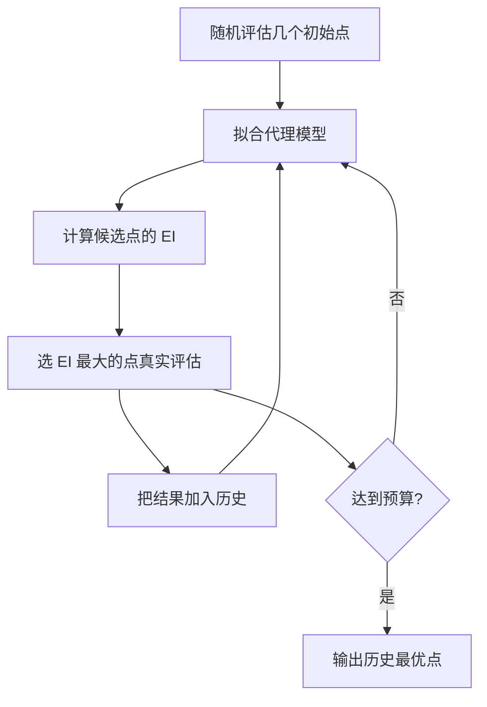

# 贝叶斯优化原理

网格搜索和随机搜索没有记忆：第 50 次抽样和第 1 次毫无关系。贝叶斯优化的核心是**用一个便宜的代理模型记住历史，用它决定下一次该试哪里**。

## 1. 调参是一个什么样的优化问题

| 性质 | 含义 |
|---|---|
| 黑盒 | 不知道“参数 → 效果”的公式，只能试一组看一次 |
| 昂贵 | 一次评估 = 跑一次 5 折交叉验证，几十秒到几小时 |
| 无导数 | 损失对超参数没有解析导数 |
| 有噪声 | 换一个 CV 划分，同一组参数的结果会小幅抖动 |

最致命的是昂贵。如果一次评估只要 0.001 秒，随机撒几百万个点就行；但一次 30 秒，每一次评估都必须有价值。

## 2. 核心思想：便宜的模型猜昂贵的函数

```text
真实函数：评估一次 30 秒      ← 尽量少调用
代理模型：评估一次 < 1 毫秒   ← 可以随便调用
```

流程：

1. 先随机真实评估几个点（比如 5 个）；
2. 用这些点拟合代理模型，预测“任意参数下的效果”；
3. 在代理模型上找最值得真实评估的下一个点；
4. 真实评估它，把结果加入历史；
5. 更新代理模型，回到第 3 步。

精髓不在某个具体算法，而在这个**代理模型 + 反复更新**的循环。

## 3. 代理模型要给两个数

普通回归只给预测值，比如“RMSE 0.45”。贝叶斯优化的代理模型还要给**不确定性**：

- 已评估区域：预测可信，不确定性小；
- 从未探索的区域：承认“不知道”，不确定性大。

输出“均值 + 置信带”的经典模型是**高斯过程**（Gaussian Process）。

```text
     真实函数未知
  ● 已评估点
       ●
              ●
                    ●
                        ●
 预测均值：一条曲线
 阴影：置信带
   已评估点附近窄，远处宽
```

## 4. 探索 vs 利用

拿到代理模型后，下一个点选哪里？

| 策略 | 做法 | 问题 |
|---|---|---|
| 纯利用 | 选预测均值最好的点 | 困在局部最优，永远发现不了没探索过的好区域 |
| 纯探索 | 选不确定性最大的点 | 一直到处乱跑，不收敛 |
| 采集函数 | 把两者合成一个数 | 平衡 |

最常用的采集函数是**期望提升（Expected Improvement, EI）**：在这个点评估，能比当前最优好多少的期望值。

EI 的四象限直觉：

| 预测均值 | 不确定性 | EI | 决策 |
|---|---|---|---|
| 好 | 大 | 高 | 重点探索（可能藏着更优点） |
| 好 | 小 | 中 | 利用（确认改进） |
| 差 | 大 | 中 | 可探索（信息价值） |
| 差 | 小 | 低 | 放弃 |

## 5. 完整循环



每一轮，代理模型对“参数 → 效果”的认知都更准。几十轮后，最优区域自然浮现。

## 6. 和手工调参的关系

有经验的工程师手工调参，大脑里跑的就是一个粗糙的贝叶斯优化：

- 第 1 次 depth=6, lr=0.1 → 0.48；
- 第 2 次 depth=8 → 0.46，“更深更好，记下来”；
- 第 3 次 depth=10 → 0.49，“边界在 8 附近”；
- 第 4 次 lr=0.05 → 0.45，“降学习率更稳”……

人在做两件事：记住历史、在“已知好区域精调（利用）”和“大胆试新值（探索）”之间切换。

人的局限：

1. 同时能记住的试验不超过 10–20 个；
2. 3 个以上参数同时变，脑内模型就崩了；
3. 容易在熟悉区域打转，不敢探索。

算法版就是把这段直觉形式化、自动化、扩展到高维。

## 7. 高斯过程的三个软肋

| 弱点 | 表现 |
|---|---|
| 维度灾难 | 参数超过约 15 个后置信带失真 |
| 离散参数 | 整数、类别参数不满足“光滑”假设 |
| 算得慢 | 评估超过 200 次后，拟合 GP 本身比训练模型还贵 |

所以 Optuna 默认不用高斯过程，而用 TPE（见 [[3.TPE与Optuna实战]]）。高斯过程在低维（≤5 个参数）、纯连续、单次评估极贵的场景（机器人参数、材料设计）仍是首选。

## 8. 相比网格/随机搜索的改进

| 维度 | 网格/随机 | 贝叶斯优化 |
|---|---|---|
| 记忆 | 无 | 用历史拟合代理模型 |
| 下一次采样 | 均匀/随机 | 由 EI 决定 |
| 算力分配 | 平均 | 向有希望的区域倾斜 |
| 何时停 | 靠预算 | 可看收敛趋势 |
| 高维 | 组合爆炸 | TPE 可处理 5–30 维 |

## 相关笔记

- [[1.调参基础与网格随机搜索]]
- [[3.TPE与Optuna实战]]
- [[4.剪枝与高级用法]]

## 来源

- `文档/第四章-超参数智能调优` 4.1–4.3
- 11.19 纪要 1、2（手工调参、代理模型、EI、探索利用）
